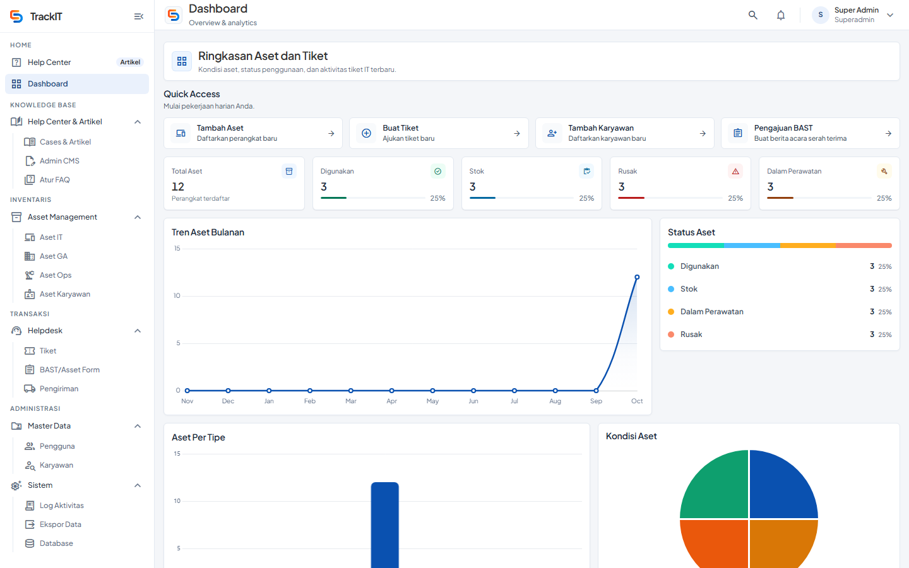
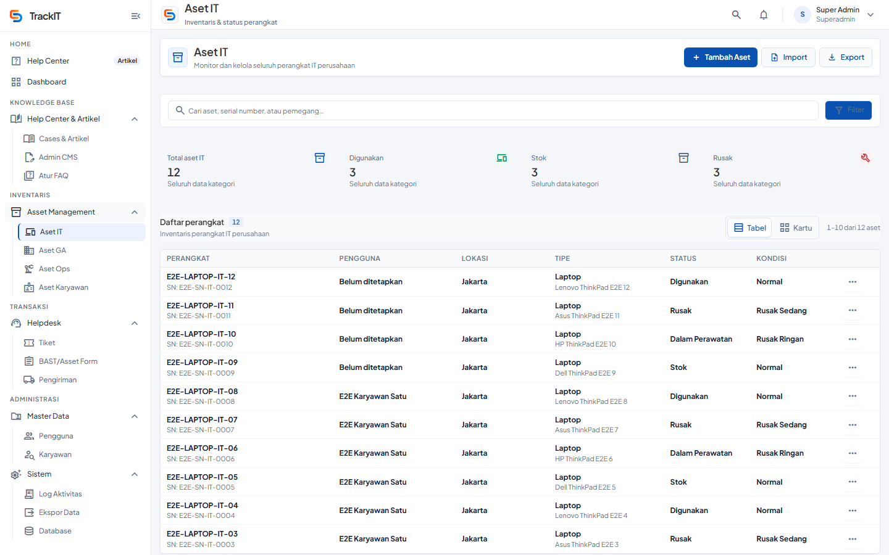
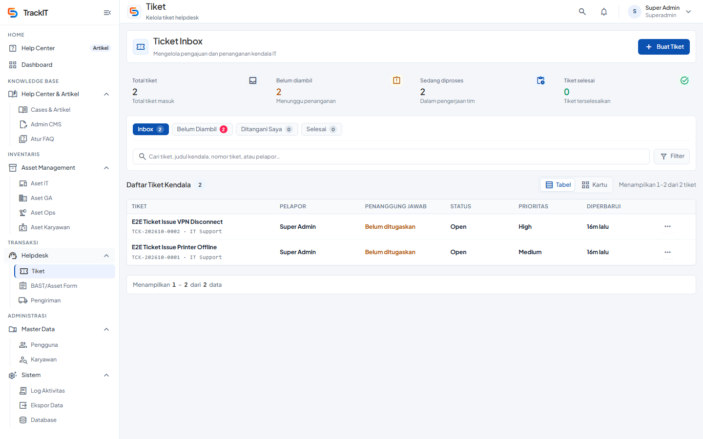
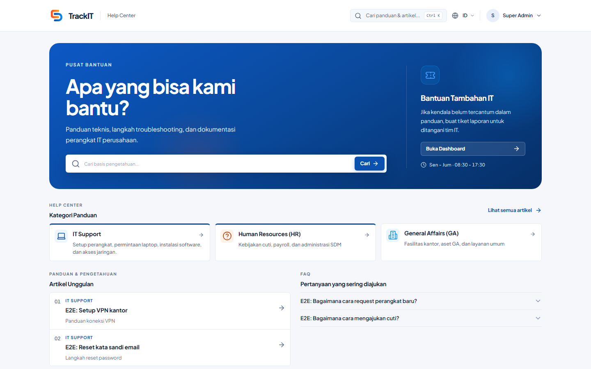
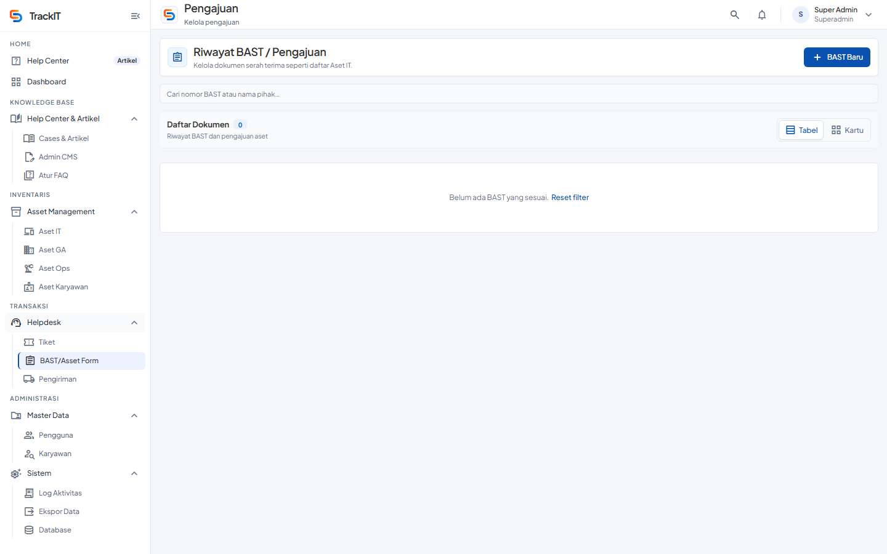
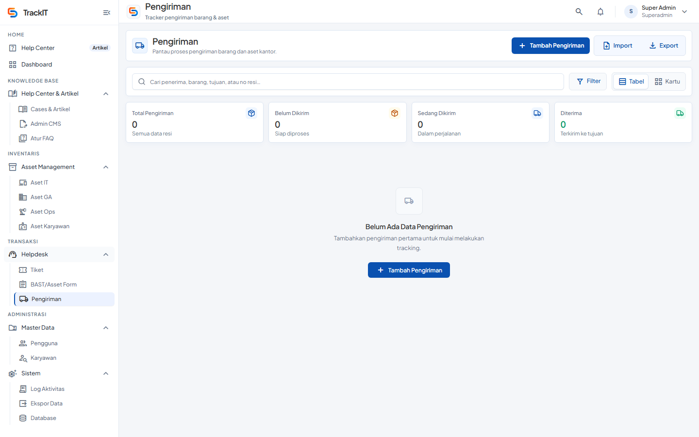
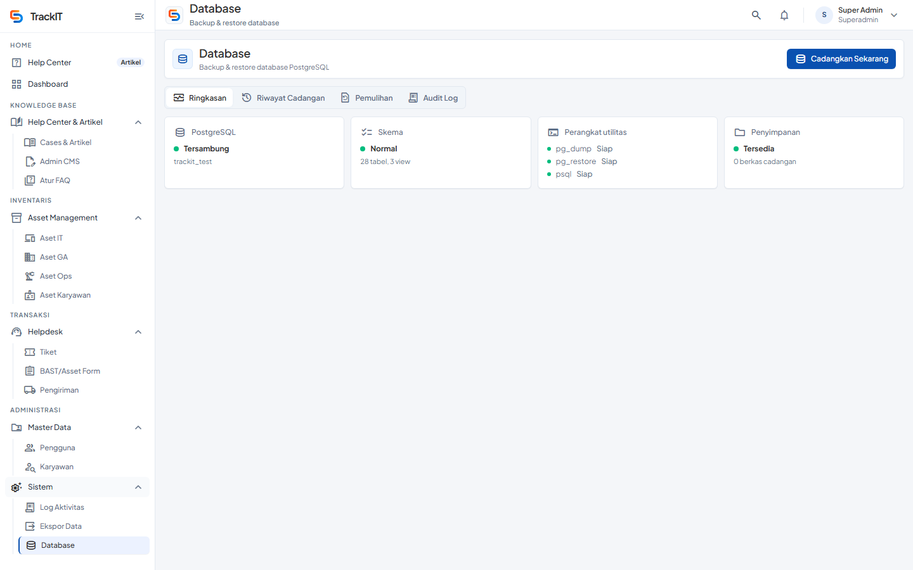
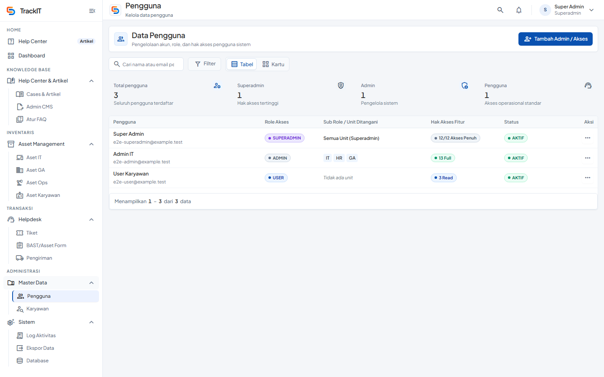
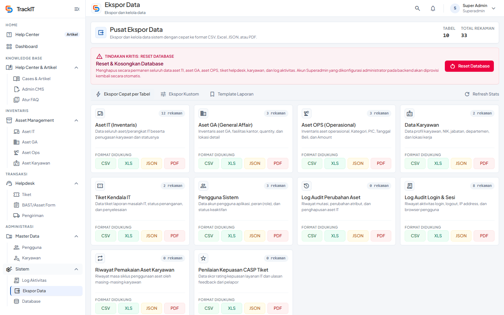
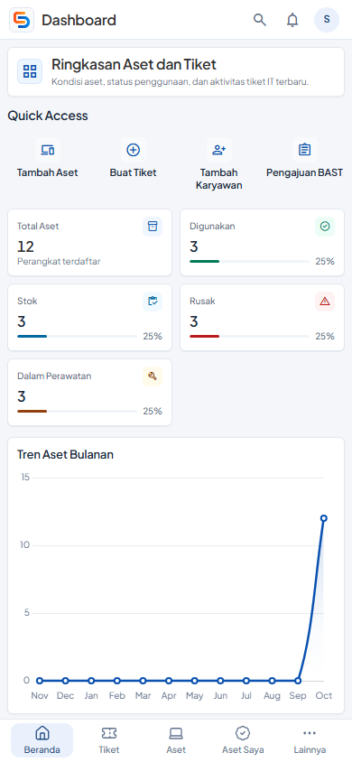

# TrackIT

TrackIT is an enterprise IT service and asset management platform for IT assets, General Affairs (GA) equipment, Operations (OPS) equipment, employee directories, procurement submissions, logistical shipments, helpdesk ticketing, and a public-facing Knowledge Base Help Center. The project is organized as a monorepo containing a Vue 3 Single Page Application (SPA), an Express 5 REST API, and a PostgreSQL 16 database.

---

## Table of Contents

- [Visual Tour](#visual-tour)
- [System Overview](#system-overview)
- [Feature Modules](#feature-modules)
  - [Asset Inventory Management](#asset-inventory-management)
  - [Helpdesk Ticketing and Realtime Updates](#helpdesk-ticketing-and-realtime-updates)
  - [Help Center and Knowledge Base CMS](#help-center-and-knowledge-base-cms)
  - [Submissions and Approval Workflows](#submissions-and-approval-workflows)
  - [Shipments and Logistics Tracking](#shipments-and-logistics-tracking)
  - [Role-Based Access Control](#role-based-access-control)
  - [Database Operations and Backup Management](#database-operations-and-backup-management)
  - [Spreadsheet Import and Export](#spreadsheet-import-and-export)
  - [System Audit Trails](#system-audit-trails)
- [Architecture and Topology](#architecture-and-topology)
- [Technology Stack](#technology-stack)
- [Directory Structure](#directory-structure)
- [Prerequisites](#prerequisites)
- [Quick Start and Local Development](#quick-start-and-local-development)
  - [1. Clone Repository and Install Dependencies](#1-clone-repository-and-install-dependencies)
  - [2. Environment Configuration](#2-environment-configuration)
  - [3. Database Setup and Migration Protocol](#3-database-setup-and-migration-protocol)
  - [4. Start Application Services](#4-start-application-services)
- [Docker Deployment](#docker-deployment)
  - [Docker Compose Local Cluster](#docker-compose-local-cluster)
  - [Container Images from GitHub Container Registry](#container-images-from-github-container-registry)
  - [Image Signature Verification with Cosign](#image-signature-verification-with-cosign)
- [Environment Variables Reference](#environment-variables-reference)
- [Database Schema and Governance](#database-schema-and-governance)
- [REST API Reference](#rest-api-reference)
- [XLSX Import and Export Specifications](#xlsx-import-and-export-specifications)
- [Security Architecture](#security-architecture)
- [Testing and Quality Assurance](#testing-and-quality-assurance)
  - [Unit Testing](#unit-testing)
  - [End-to-End Testing with Playwright](#end-to-end-testing-with-playwright)
  - [Automated Accessibility Checks](#automated-accessibility-checks)
  - [Static Security Analysis](#static-security-analysis)
- [Production Deployment Runbook](#production-deployment-runbook)
- [Troubleshooting](#troubleshooting)
- [Changelog](#changelog)
- [Contributing](#contributing)
- [License](#license)

---

## Visual Tour

### Operations Dashboard
Central overview displaying real-time asset distribution, hardware condition metrics, device type composition, ticket volume, and Customer Satisfaction (CSAT) trends.



### IT Asset Inventory
Multi-domain asset registry supporting assignment tracking, hardware specifications, status transitions, barcode generation, and search filtering.



### Helpdesk Ticketing System
Queue-segregated service desk featuring priority tiers, agent claim workflows, audit timelines, attachment uploads, and live Server-Sent Events updates.



### Public Help Center and Knowledge Base
Self-service portal presenting published Standard Operating Procedure (SOP) articles, frequently asked questions, categorized topic cards, and popular search discovery.



### Asset Submissions and Approvals
Employee asset request tracking with status progressions, approval auditing, and specification review.



### Logistics and Shipments
Hardware dispatch monitoring featuring recipient routing, courier tracking numbers (AWB), and transit progression.



### Database Administration and Backup Control
Web-based backup creation, verification, on-demand restoration, and SHA-256 integrity inspection.



### User Administration and Granular RBAC
Account provisioning, role assignment, and granular matrix configuration across 13 feature permission keys.



### Spreadsheet Data Export
Administrative XLSX export facility with dynamic column filtering and formula injection neutralization.



### Mobile Responsive Layout
Dense, touch-friendly interface optimized for smartphone and tablet viewports without horizontal clipping.



---

## System Overview

TrackIT addresses the operational workflows of three primary user groups:

1. **Employees:** Review personally assigned hardware, submit repair or provisioning tickets, track ticket resolutions, rate completed tickets (CSAT), and consult public Help Center documentation.
2. **Operations Teams (IT, General Affairs, Operations):** Manage hardware lifecycles across designated asset pools, triage ticket queues, process equipment requests, log outgoing logistics shipments, and author Knowledge Base guides.
3. **System Administrators:** Provision user accounts, configure per-feature permission levels, audit administrative modifications, perform secured XLSX data transfers, and manage database snapshots directly from the web interface.

All management interfaces require authentication. Only published Help Center resources (articles, FAQs, and category definitions) are accessible without active user credentials.

---

## Feature Modules

### Asset Inventory Management
- **Domain Segregation:** Three distinct asset pools for IT hardware (`aset_ti`), General Affairs facilities (`aset_ga`), and Operations equipment (`aset_ops`).
- **Hardware Lifecycle:** Status management covering Available, In Use, Maintenance, and Decommissioned states.
- **Custody Tracking:** Relational linking between individual equipment records and employee profiles (`karyawan`) with historical usage logs (`riwayat_pemakaian_aset`).
- **Barcode Generation:** Client-side barcode rendering (JsBarcode) for asset tags and equipment labels.
- **Specification Tracking:** Hostname, serial number, processor, RAM, storage, operating system, vendor, acquisition date, and purchase value.

### Helpdesk Ticketing and Realtime Updates
- **Queue Segregation:** Independent ticket queues for IT Support, Human Resources, and General Affairs teams.
- **Workflow Transitions:** Ticket states moving through Open, In Progress, Resolved, and Closed.
- **Collaboration:** Threaded comments supporting file attachments and timestamped audit logs for every field mutation.
- **Realtime Dispatch:** Server-Sent Events (SSE) via `GET /api/tickets/events`, delivering instant queue and comment notifications filtered by individual user access privileges.
- **Satisfaction Measurement:** Automated post-resolution Customer Satisfaction (CSAT) score collection on a 1 to 5 scale.

### Help Center and Knowledge Base CMS
- **Public Portal:** Searchable incident guides, SOP documents, categorized topic cards, and searchable FAQs.
- **TipTap Rich Text Editor:** In-browser article composition with typography hierarchy, inline code blocks, tables, and image embedding.
- **Lifecycle Gating:** Content draft and publication states. Unauthenticated visitors can only view documents marked `PUBLISHED`.
- **Search Logging:** Capture of visitor search queries to determine frequent documentation requests without tracking personal identifiers.
- **User Bookmarks:** Authenticated bookmarking for employees to keep frequently referenced procedures accessible.

### Submissions and Approval Workflows
- **Procurement and Provisioning Requests:** Structured employee requests for new hardware, replacement components, or access credentials.
- **Review Protocol:** Administrative triage with approval, rejection, and fulfillment statuses.
- **Audit Association:** Direct linkages between approved submissions and newly assigned asset inventory rows.

### Shipments and Logistics Tracking
- **Hardware Logistics:** Dispatch recording for remote employees, branch offices, and third-party repair vendors.
- **Tracking Identifiers:** Air Waybill (AWB) number association, courier identification, origin, and destination addresses.
- **Transit States:** Tracking from Dispatch to In Transit, Delivered, and Cancelled.

### Role-Based Access Control
- **Global Roles:** Three platform tiers: `user`, `admin`, and `superadmin`.
- **Granular Feature Matrix:** Thirteen independent permission keys evaluated on every mutating API request:
  - `dashboard`
  - `assets` (IT Inventory)
  - `assets_ga` (GA Inventory)
  - `assets_ops` (Operations Inventory)
  - `my_assets` (Self-service Employee Inventory)
  - `tickets` (Helpdesk Queues)
  - `submissions` (Asset Requests)
  - `shipments` (Logistics)
  - `users` (Account Management)
  - `logs` (Audit System)
  - `karyawan` (Employee Master Data)
  - `export` (XLSX Data Extraction)
  - `knowledge_base` (Help Center CMS)
- **Permission Levels:** Each key can be assigned `none`, `read_only`, or `full` access.

### Database Operations and Backup Management
- **Administrative Snapshots:** Superadmin-triggered `pg_dump` backups executed through the server runtime.
- **Cryptographic Verification:** SHA-256 checksum generation and validation for all archive files.
- **Pre-Restoration Safeguards:** Automatic snapshot creation prior to executing any database restore operation.
- **Retention Policies:** Configurable limits governing maximum archive count and storage age.
- **Audit Tracking:** Comprehensive operational logging for all backup creations, downloads, validations, and restorations.

### Spreadsheet Import and Export
- **Formula Injection Mitigation:** Sanitization of cell strings starting with `=`, `+`, `-`, or `@` to neutralize spreadsheet code execution upon opening files in Microsoft Excel or LibreOffice Calc.
- **Template Compatibility:** Exported file headers and sheet structures match import requirements, allowing round-trip data adjustments.
- **Dual Import Modes:**
  - *Append Mode:* Inserts non-conflicting records alongside existing entries.
  - *Replace All Mode:* Purges existing target category records prior to batch insertion, guarded by a mandatory confirmation token (`GANTI`) validated both client-side and server-side.

### System Audit Trails
- **Central Mutation Ledger:** `system_audit_logs` records JSONB state representations before and after modifications.
- **Context Capture:** Actor identifier, client IP address, user-agent string, affected module, and specific record ID.
- **Authentication Tracking:** `log_audit_login` stores successful logins, failed attempts, and account lockout events.

---

## Architecture and Topology

TrackIT uses a monorepo structure separating concerns across presentation, routing, business logic, and persistence.

```text
+--------------------------------------------------------------------+
|                         CLIENT BROWSER                             |
|  Vue 3 Single Page Application (Tailwind CSS 4 + Lucide Icons)     |
+--------------------------------------------------------------------+
                                   |
                     HTTP / HTTPS (Port 80 / 443)
                     Same-Origin API Proxy (/api)
                                   v
+--------------------------------------------------------------------+
|                    REVERSE PROXY (Nginx / Vite)                    |
|  - Serves static SPA bundle (dist/)                                |
|  - Injects Content Security Policy and HTTP security headers       |
|  - Forwards /api traffic to Node.js backend                        |
|  - Disables proxy buffering for Server-Sent Events (SSE)           |
+--------------------------------------------------------------------+
                                   |
                         HTTP (Internal Port 3000)
                                   v
+--------------------------------------------------------------------+
|                     BACKEND REST API (Express 5)                   |
|  +--------------------------------------------------------------+  |
|  | Middleware Stack:                                            |  |
|  | - Security Headers (Helmet, CSP, Permissions-Policy)         |  |
|  | - CORS Allowlist Enforcement                                 |  |
|  | - Layered Rate Limiting (Global, Per-User, Auth Endpoints)   |  |
|  | - Session Validation (HttpOnly Cookie -> Server Verification)|  |
|  | - Granular RBAC Permission Verification                      |  |
|  +--------------------------------------------------------------+  |
|  | Routing and Controllers: Input validation, schema mapping    |  |
|  | Services: Business logic, in-process EventBus, parameterized |  |
|  |           PostgreSQL connection pool (pg)                    |  |
|  +--------------------------------------------------------------+  |
+--------------------------------------------------------------------+
                                   |
                      TCP Connection Pool (Port 5432)
                                   v
+--------------------------------------------------------------------+
|                      DATABASE (PostgreSQL 16)                      |
|  - 24 Relational Tables, 3 Analytical Views                        |
|  - Schema evolution governed by Versioned SQL Migrations           |
|  - Soft-delete enforcement via database triggers                   |
|  - Automatic updated_at timestamp triggers                         |
|  - Partial indices for optimized active-record queries             |
+--------------------------------------------------------------------+
```

### Architectural Principles

- **Three-Tier Backend Separation:** `routes` handle endpoint mapping and middleware attachment; `controllers` parse and sanitize HTTP payloads; `services` execute domain logic and construct parameterized SQL statements.
- **Zero Startup DDL:** The API server never executes schema modifications during startup. Startup routines verify schema compatibility against `app_schema_migrations` and exit if migrations are pending.
- **Server-Side Security Authority:** The backend is the single source of truth for authorization. Frontend permission guards only prevent unnecessary navigation; every API route enforces permissions independently.
- **Session Architecture:** Authentication relies on an HttpOnly `trackit_session` cookie containing a signed JWT. Active tokens are paired with a revocable `user_sessions` database record, allowing server-side session invalidation upon logout or administrative revocation.

---

## Technology Stack

| Layer | Component | Version / Library | Purpose |
| --- | --- | --- | --- |
| **Frontend Framework** | Vue.js | 3.5.x | Reactive UI components with Composition API |
| **Build Tooling** | Vite | 6.x / 8.x | Frontend build pipeline and local development server |
| **Styling** | Tailwind CSS | 4.x | Utility-first design tokens and responsive styling |
| **Typography** | Plus Jakarta Sans | Google Fonts | Unified corporate typography baseline |
| **Rich Text CMS** | TipTap | 3.30.x | Markdown and rich text editor for Help Center articles |
| **Data Visualization** | Chart.js & vue-chartjs | 4.5.x | Operations dashboard analytics charts |
| **Barcode Utilities** | JsBarcode | 3.12.x | Code128 asset tag and inventory label rendering |
| **Icons** | Lucide Vue Next | 0.475.x | Functional iconography across UI views |
| **Backend Runtime** | Node.js (ESM) | ^22.18.0 or >=24.12.0 | High-performance asynchronous JavaScript engine |
| **Web Server Framework**| Express | 5.2.x | HTTP routing, middleware pipeline, and REST APIs |
| **Database Driver** | pg (node-postgres) | 8.22.x | PostgreSQL client pool with parameterized queries |
| **Database Engine** | PostgreSQL | 16.x | Relational database with trigger functions and views |
| **Spreadsheet Engine** | SheetJS (xlsx) | 0.20.x | Workbook parsing, sheet extraction, and XLSX generation |
| **Sanitization** | DOMPurify | 3.4.x / 4.1.x | Client and server HTML sanitization against XSS |
| **Authentication** | jsonwebtoken & bcryptjs | 9.0.x / 3.0.x | Salted password hashing and signed session tokens |
| **End-to-End Testing** | Playwright | 1.50.x | Automated multi-browser integration tests |
| **Accessibility Testing**| axe-core | 4.13.x | Automated WCAG 2.1 AA compliance validation |
| **Containers** | Docker & Docker Compose | Compose v2 | Containerized local orchestration and multi-stage builds |

---

## Directory Structure

```text
trackit/
├── backend/                        Express 5 REST API application
│   ├── migrations/
│   │   ├── versioned/              Canonical version-controlled SQL migrations
│   │   └── 0xx_*.sql               Archival legacy reference scripts (do not execute)
│   ├── src/
│   │   ├── assets/                 Static server assets and logos
│   │   ├── config/                 Database configuration, migration runner, schema checks
│   │   ├── controllers/            Request parsing, validation, and HTTP dispatch
│   │   ├── middleware/             Auth, rate limiting, security headers, audit hooks
│   │   ├── routes/                 API route declarations and legacy aliases
│   │   ├── security/               CORS allowlists, session token generation
│   │   ├── services/               Domain business logic, parameterized SQL, event dispatch
│   │   ├── utils/                  Security helpers, identifiers, sanitizers
│   │   ├── app.js                  Express application assembly and middleware binding
│   │   └── server.js               Server initialization and graceful shutdown handlers
│   ├── tests/                      Node.js test runner unit suites (node --test)
│   ├── Dockerfile                  Production API container definition
│   └── package.json                Backend dependencies and scripts
│
├── frontend/                       Vue 3 SPA client application
│   ├── public/                     Static web assets, icons, manifest files
│   ├── src/
│   │   ├── assets/                 Core stylesheets and layout tokens
│   │   ├── components/
│   │   │   ├── cases/              Help Center article cards and viewer components
│   │   │   ├── dashboard/          KPI cards and dashboard metric summaries
│   │   │   ├── layout/             AppHeader, AppSidebar, AppBottomNav, PageHeader
│   │   │   ├── tickets/            Ticket queues, detail drawers, comment threads
│   │   │   └── ui/                 Shared UI kit (AppButton, DataTable, Modal, Toast)
│   │   ├── composables/            State management composables (useApi, useAuth, useToast)
│   │   ├── config/                 Navigation routing configs and feature mappings
│   │   ├── router/                 Vue Router route mappings and permission guards
│   │   ├── services/               Client-side API service integrations
│   │   ├── utils/                  Formatters, sanitizers, barcode helpers
│   │   ├── views/                  Top-level page views (Dashboard, Assets, Tickets, etc.)
│   │   │   └── admin/              Administrative views (Users, Database, Categories, CMS)
│   │   ├── App.vue                 Root component mounting layouts, modals, and toasts
│   │   └── main.js                 Application entry point and plugin registration
│   ├── tests/                      Frontend unit test specifications
│   ├── nginx.conf                  Production Nginx configuration (reverse proxy + headers)
│   ├── vite.config.js              Vite build configuration and dev proxy settings
│   ├── Dockerfile                  Multi-stage Nginx production container
│   └── package.json                Frontend dependencies and linting scripts
│
├── docs/                           Engineering documentation and audit records
│   ├── audits/                     Historical UI and UX compliance audit reports
│   ├── deploy/                     Production deployment manifests and templates
│   ├── screenshots/                Curated application interface screenshots
│   ├── CONVENTIONS.md              Code conventions, SQL requirements, testing rules
│   ├── PRODUCTION_QA_REPORT.md     Production quality assurance sign-off reports
│   └── database-migration-adoption.md Adoption runbook for existing database instances
│
├── e2e/                            Playwright End-to-End test framework
│   ├── fixtures/                   Disposable test data and database seed helpers
│   ├── pages/                      Page Object Model (POM) representations
│   └── tests/                      31 test specifications covering core functional flows
│
├── scripts/                        Automation utilities, QA tooling, and seed helpers
│   ├── build-tokens.js             Design token compiler
│   ├── initialize-test-database.mjs Automated loopback test database initializer
│   └── qa/                         Non-production regression and QA verification scripts
│
├── design-tokens/                  Source JSON design tokens for typography and colors
├── .github/workflows/              GitHub Actions CI/CD pipeline definitions
├── docker-compose.yml              Multi-container development and deployment stack
├── playwright.config.js            Playwright test runner configuration
└── package.json                    Root package scripts for testing, tokens, and docs
```

---

## Prerequisites

- **Node.js:** Supported versions `^22.18.0` or `>=24.12.0`.
- **Package Manager:** `npm` (bundled with Node.js).
- **Database:** PostgreSQL 16 server (local installation or container).
- **Container Engine (Optional):** Docker 24+ and Docker Compose v2.
- **Browsers for E2E (Optional):** Chromium and Firefox via `npx playwright install`.

---

## Quick Start and Local Development

### 1. Clone Repository and Install Dependencies

```bash
git clone https://github.com/muhhlmy/esb-trackit.git
cd esb-trackit

# Install root dependencies (Playwright, linters)
npm ci

# Install backend dependencies
npm --prefix backend ci

# Install frontend dependencies
npm --prefix frontend ci
```

### 2. Environment Configuration

Create local environment configuration files from provided templates:

```bash
# Root and Docker Compose configuration
cp .env.example .env

# Local backend API configuration
cp backend/.env.example backend/.env

# Local frontend configuration
cp frontend/.env.example frontend/.env

# Local End-to-End testing configuration (optional)
cp .env.e2e.example .env.e2e
```

Configure your local `backend/.env` with your PostgreSQL database credentials and a secure JWT secret:

```env
PORT=3000
DB_HOST=localhost
DB_PORT=5432
DB_NAME=trackit
DB_USER=postgres
DB_PASSWORD=your_local_postgres_password
JWT_SECRET=super_secret_key_minimum_32_characters_random_string
CORS_ORIGINS=http://localhost:5173
```

### 3. Database Setup and Migration Protocol

Ensure PostgreSQL 16 is running on `localhost:5432` with a database named `trackit`.

Execute schema migrations using the migration runner:

```bash
# Review pending migrations without applying changes
npm --prefix backend run db:migrate:plan

# Apply migrations with required environment guards
ALLOW_DB_MIGRATIONS=true \
MIGRATION_MODE=fresh \
MIGRATION_EXPECTED_HOST=localhost \
MIGRATION_EXPECTED_DATABASE=trackit \
MIGRATION_RECOVERY_PROOF_ID=local_dev_init \
npm --prefix backend run db:migrate:apply

# Verify runtime schema expectations
npm --prefix backend run db:check
```

### 4. Start Application Services

Start the backend API server:

```bash
npm --prefix backend run dev
```
The API server begins listening on `http://localhost:3000`. You can confirm server and database status at `http://localhost:3000/health`.

In a separate terminal, launch the frontend development server:

```bash
npm --prefix frontend run dev
```
The SPA interface will be available at `http://localhost:5173`. Vite automatically proxies `/api` requests to `http://localhost:3000`.

---

## Docker Deployment

### Docker Compose Local Cluster

The provided `docker-compose.yml` deploys a complete four-service stack:

1. `postgres`: PostgreSQL 16 Alpine container with persistent volumes and healthchecks.
2. `migrate`: Ephemeral runner executing versioned migrations before the API starts.
3. `backend`: Node.js 22 container running the Express API with `postgresql-client` for backup tasks.
4. `frontend`: Multi-stage Nginx container serving the compiled SPA and reverse-proxying `/api`.

To start the cluster:

```bash
# Verify .env has DB_PASSWORD, JWT_SECRET, and migration guards set
docker compose up --build -d
```

Access the application at `http://localhost` (exposed on standard HTTP port 80).

To view runtime container output:

```bash
docker compose logs -f
```

To stop all services:

```bash
docker compose down
```

### Container Images from GitHub Container Registry

Automated GitHub Actions workflows publish production-ready container images to the GitHub Packages Container Registry (GHCR) on each release tag:

```bash
# Pull backend image
docker pull ghcr.io/muhhlmy/esb-trackit-backend:latest

# Pull frontend image
docker pull ghcr.io/muhhlmy/esb-trackit-frontend:latest
```

### Image Signature Verification with Cosign

Images published to GHCR are cryptographically signed using Cosign via GitHub Actions OIDC tokens. You can verify container provenance before deploying:

```bash
cosign verify \
  --certificate-identity-regexp '^https://github.com/muhhlmy/esb-trackit/\.github/workflows/' \
  --certificate-oidc-issuer https://token.actions.githubusercontent.com \
  ghcr.io/muhhlmy/esb-trackit-backend:latest
```

---

## Environment Variables Reference

### Backend Configuration (`backend/.env`)

| Variable | Requirement | Default | Description |
| --- | --- | --- | --- |
| `PORT` | Optional | `3000` | HTTP port for the Express application server |
| `HOST` | Optional | `0.0.0.0` | Network binding interface |
| `NODE_ENV` | Optional | `development` | Runtime environment mode (`development`, `production`, `test`) |
| `DB_HOST` | Required | `localhost` | PostgreSQL database host address |
| `DB_PORT` | Optional | `5432` | PostgreSQL database service port |
| `DB_NAME` | Required | None | PostgreSQL database name |
| `DB_USER` | Required | None | PostgreSQL username |
| `DB_PASSWORD` | Required | None | PostgreSQL user password |
| `JWT_SECRET` | Required | None | Cryptographic secret for signing tokens (minimum 32 characters) |
| `CORS_ORIGINS` | Required | None | Comma-separated list of exact allowed browser origins (wildcards prohibited) |
| `TRUST_PROXY_CIDRS` | Optional | Empty | Comma-separated trusted upstream proxy CIDR blocks (e.g. `172.28.0.0/16`) |
| `SESSION_COOKIE_NAME`| Optional | `trackit_session` | Name of the HttpOnly session cookie |
| `SESSION_COOKIE_SECURE`| Optional | `false` | Sets `Secure` flag on cookies (must be `true` behind HTTPS) |
| `EMAIL_ENABLED` | Optional | `false` | Enables transactional email dispatch for password resets |
| `SMTP_HOST` | Optional | Empty | SMTP server hostname |
| `SMTP_PORT` | Optional | `587` | SMTP service port |
| `SMTP_SECURE` | Optional | `false` | Enforces TLS for SMTP connections |
| `SMTP_USER` | Optional | Empty | SMTP authentication username |
| `SMTP_PASS` | Optional | Empty | SMTP authentication password |
| `EMAIL_FROM` | Optional | Empty | Sender email address for outgoing messages |
| `ENABLE_DB_RESET` | Optional | `false` | Enables database purge endpoint (prohibited in production) |

### Migration Guard Variables

The migration runner enforces mandatory guard variables to prevent accidental schema changes:

| Variable | Requirement | Expected Value | Description |
| --- | --- | --- | --- |
| `ALLOW_DB_MIGRATIONS` | Mandatory | `true` | Explicit acknowledgment of intent to modify schema |
| `MIGRATION_MODE` | Mandatory | `fresh` or `existing` | Context of database target (`fresh` for initial setup) |
| `MIGRATION_EXPECTED_HOST` | Mandatory | Exact match | Verifies connection host matches command target |
| `MIGRATION_EXPECTED_DATABASE` | Mandatory | Exact match | Verifies target database name matches command target |
| `MIGRATION_RECOVERY_PROOF_ID`| Mandatory | String ID | Unique recovery backup proof ID before changes |
| `MIGRATION_CHANGE_ID` | Production | Change Ticket | Change management reference for production tracking |

---

## Database Schema and Governance

TrackIT uses PostgreSQL 16. The database structure contains 24 relational tables, 3 analytical views, and trigger-enforced constraints.

### Schema Architecture

| Category | Objects | Purpose |
| --- | --- | --- |
| **Authentication & Accounts** | `users`, `karyawan`, `user_sessions`, `account_security_state`, `password_reset_otps` | Identity, session management, brute-force state, password reset |
| **Asset Inventories** | `aset_ti`, `aset_ga`, `aset_ops`, `asset_submissions`, `riwayat_pemakaian_aset`, `log_riwayat_aset` | Equipment inventory across domains, employee assignment history |
| **Service Desk** | `ticket_queues`, `tickets`, `komentar_tiket`, `ticket_casp_ratings`, `user_ticket_queues`, `log_riwayat_tiket` | Queues, tickets, threaded commentary, CSAT feedback ratings |
| **Help Center Portal** | `faq`, `cases`, `kb_categories`, `kb_search_logs`, `case_bookmarks` | SOP documentation, FAQ entries, category taxonomy, user bookmarks |
| **Logistics** | `asset_shipments` | Courier consignments, AWB tracking, delivery statuses |
| **System Audit & Backups** | `system_audit_logs`, `log_audit_login`, `backup_metadata`, `backup_audit_log` | Central JSONB audit trail, login logs, backup catalogs |
| **Analytical Views** | `daftar_aset_ti_lengkap`, `v_ticket_stats_per_queue`, `v_employee_asset_summary` | Denormalized queries for reporting and dashboard widgets |

### Database Integrity Constraints

- **Soft Delete Protections:** Tables including `users`, `aset_ti`, and `tickets` utilize soft deletion (`deleted_at`). Trigger functions block manual `DELETE` statements on critical records.
- **Automated Timestamp Tracking:** An `auto_update_timestamp()` trigger updates the `updated_at` column across all primary tables on each record mutation.
- **Enum Safeguards:** State columns use explicit SQL `CHECK` constraints, guaranteeing data validity independent of application code.
- **Partial Indices:** Indices applied conditionally on active records (`WHERE deleted_at IS NULL`) optimize query performance.

---

## REST API Reference

All application endpoints are served under the `/api` prefix. Mutating HTTP requests (`POST`, `PUT`, `PATCH`, `DELETE`) require the `Content-Type: application/json` header.

### Authentication Endpoints

| Method | Endpoint | Access Level | Description |
| --- | --- | --- | --- |
| `POST` | `/api/auth/login` | Public (Rate-limited) | Validates credentials and sets HttpOnly session cookie |
| `POST` | `/api/auth/logout` | Authenticated | Revokes current session record in database |
| `GET` | `/api/auth/me` | Authenticated | Retrieves current authenticated user profile and permissions |
| `POST` | `/api/auth/change-password` | Authenticated | Updates current user password |
| `POST` | `/api/auth/forgot-password` | Public (Rate-limited) | Initiates password reset procedure and dispatches OTP |
| `POST` | `/api/auth/verify-reset-otp`| Public (Rate-limited) | Validates OTP hash before password replacement |
| `POST` | `/api/auth/reset-password` | Public (Rate-limited) | Sets new password following verified OTP confirmation |

### Core Operational Endpoints

| Method | Endpoint | Required Permission | Description |
| --- | --- | --- | --- |
| `GET`, `POST` | `/api/assets` | `assets` (Read / Full) | List and create IT asset records |
| `GET`, `PUT`, `DELETE`| `/api/assets/:id` | `assets` (Read / Full) | Retrieve, modify, or archive specific IT asset |
| `GET` | `/api/assets/my` | `my_assets` (Read) | Retrieve hardware currently assigned to logged-in employee |
| `GET` | `/api/assets/stats` | `assets` (Read) | Summary metrics on asset conditions and classifications |
| `GET`, `POST` | `/api/ga-assets` | `assets_ga` (Read / Full) | List and create General Affairs asset records |
| `GET`, `POST` | `/api/ops-assets` | `assets_ops` (Read / Full) | List and create Operations asset records |
| `GET`, `POST` | `/api/tickets` | `tickets` (Read / Full) | List and open helpdesk service tickets |
| `GET` | `/api/tickets/events` | `tickets` (Read) | Server-Sent Events stream for realtime ticket notifications |
| `POST` | `/api/tickets/:id/comments` | `tickets` (Full) | Append message or attachment to ticket conversation |
| `POST` | `/api/tickets/:id/claim` | `tickets` (Full) | Assign ticket to the currently authenticated agent |
| `POST` | `/api/tickets/:id/csat` | `tickets` (Full) | Record customer satisfaction rating for resolved ticket |
| `GET`, `POST` | `/api/submissions` | `submissions` (Read / Full) | List and create employee hardware requests |
| `GET`, `POST` | `/api/shipments` | `shipments` (Read / Full) | List and create courier tracking records |

### Public Help Center Endpoints

| Method | Endpoint | Access Level | Description |
| --- | --- | --- | --- |
| `GET` | `/api/cases/public` | Public | List published Help Center incident and SOP articles |
| `GET` | `/api/cases/public/:id` | Public | Retrieve published article content and metadata |
| `GET` | `/api/faqs/public` | Public | List published frequently asked questions |
| `GET` | `/api/kb-categories/public` | Public | List active topic categories for Help Center cards |
| `GET` | `/api/kb-search-logs/popular`| Public | Retrieve aggregate list of frequent search terms |
| `POST`| `/api/kb-search-logs` | Public | Log a search term query for analytics |

### Administrative Endpoints

| Method | Endpoint | Required Permission | Description |
| --- | --- | --- | --- |
| `GET`, `POST` | `/api/employees` | `karyawan` (Admin) | Manage employee master data directory |
| `GET`, `POST` | `/api/users` | `users` (Admin) | Manage system user accounts and permission matrices |
| `GET` | `/api/logs` | `logs` (Admin) | Retrieve system audit logs and login records |
| `POST` | `/api/import/excel` | Admin | Batch import employee and IT asset data from XLSX |
| `POST` | `/api/import/excel-assets` | Admin | Batch import GA assets, OPS assets, or shipments |
| `GET`, `POST` | `/api/export/*` | `export` (Superadmin) | Export system records to sanitized XLSX workbooks |
| `GET`, `PUT` | `/api/settings/email` | Superadmin | Read or update transactional SMTP configuration and triggers |
| `POST` | `/api/settings/email/test` | Superadmin | Dispatch test verification email to target address |
| `GET`, `PUT`, `POST` | `/api/settings/email/templates/*` | Superadmin | Manage dynamic HTML email templates and resets |
| `GET` | `/api/admin/database/status` | Superadmin | Check database connectivity and migration version |
| `GET`, `POST` | `/api/admin/database/backups`| Superadmin | List existing backups or trigger new snapshot |
| `POST` | `/api/admin/database/restore`| Superadmin | Restore database from an existing or uploaded dump file |
| `GET` | `/health` | Public | Service healthcheck returning database connection state |

---

## XLSX Import and Export Specifications

### Security Safeguards

To prevent Formula Injection attacks, all exported spreadsheet cells beginning with dangerous characters (`=`, `+`, `-`, `@`) have their values prepended with a single quote character (`'`). This prevents spreadsheet calculation engines from executing arbitrary code while preserving readable content.

### Import Mappings and Schemas

| Module | Target Sheet Name | Key Identifiers | Notes |
| --- | --- | --- | --- |
| Employee Master | `Table Karyawan` | `NIK` | Import employees first to establish asset custody links |
| IT Assets | `Table Asset` | `hostname`, `serial_number` | Requires existing employee NIK for assigned equipment |
| Full IT Registry | `Table Karyawan` + `Table Asset` | `NIK`, `hostname` | Dual-sheet workbook creating employees and assets simultaneously |
| GA Assets | `Data Aset GA` | `hostname` / `nomor_aset` | General Affairs facility and vehicle registry |
| OPS Assets | `Data Aset OPS` | `hostname` / `nomor_aset` | Operational field hardware registry |
| Shipments | `Data Pengiriman` | `resi` (AWB Number) | Logistics tracking with courier names and destinations |

### Replace All Protocol

When performing batch imports using the *Replace All* mode, existing category records are purged before inserting spreadsheet rows. To prevent accidental data loss, the administrative user must confirm the action by typing `GANTI` into the confirmation dialog. The backend re-validates this confirmation string prior to opening a database transaction.

---

## Security Architecture

TrackIT applies defense-in-depth principles across transport, application logic, and storage:

1. **Authentication:** Signed JSON Web Tokens with a 15-minute validity window, delivered via HttpOnly cookies with `SameSite=Lax`. Tokens are validated against database session records on every request, enabling immediate revocation upon logout.
2. **Access Control:** Every API route verifies both global role requirements and specific feature permission keys (`none`, `read_only`, `full`). Client-side checks only assist navigation rendering.
3. **Password Security:** Hashes generated using `bcryptjs` with bounded salt rounds (12 rounds standard). Legacy or non-standard hash algorithms fail closed.
4. **Brute Force Protection:** Account lockout records stored in `account_security_state` temporarily disable accounts exceeding failed attempt thresholds.
5. **Content Security Policy (CSP):** Express middleware and Nginx configurations enforce strict script, style, and object source restrictions.
6. **Input Validation and XSS Sanitization:** Incoming HTML bodies for Help Center articles are sanitized using `isomorphic-dompurify` on the backend and re-sanitized using `dompurify` before browser rendering.
7. **Rate Limiting:** Multi-tiered express rate limiters protecting public endpoints, login routes, and general authenticated APIs. SSE streams are exempted from standard limits to prevent unexpected disconnections.
8. **Container Hardening:** Docker production containers drop all Linux capabilities (`cap_drop: ALL`), disable privilege escalation (`no-new-privileges: true`), and run under dedicated unprivileged system users.

---

## Testing and Quality Assurance

### Unit Testing

Unit tests for backend business logic, validation routines, and frontend components run using the native Node.js test runner:

```bash
# Execute backend unit test suite
npm run test:backend

# Execute frontend unit test suite
npm run test:frontend
```

### End-to-End Testing with Playwright

TrackIT includes 31 End-to-End specification files covering complete user journeys, authentication lifecycles, ticketing workflows, access control, and edge-case errors.

Safety Rule: Playwright is strictly guarded to execute only against local loopback database hosts (`localhost`, `127.0.0.1`) where the target database name ends with `_test`. Tests will immediately abort if pointed toward a shared or production database.

To execute the End-to-End test suite:

```bash
# Prepare disposable test database and execute suite
npm run test:e2e

# Run tests with visible browser windows
npm run test:e2e:headed

# Run interactive Playwright UI mode
npm run test:e2e:ui

# Execute smoke tests only
npm run test:e2e:smoke
```

### Automated Accessibility Checks

Accessibility audits are integrated into Playwright test runs using `@axe-core/playwright`. All public Help Center pages and internal management views are verified for WCAG 2.1 AA compliance, including color contrast thresholds, keyboard navigation, focus indicators, and semantic heading structure.

### Static Security Analysis

- **GitHub CodeQL:** Automated static application security testing (SAST) runs on every pull request targeting the `main` branch to detect injection vulnerabilities and dangerous dependencies.
- **Dependency Auditing:** Automated vulnerability scanning via `npm audit --audit-level=high`.

---

## Production Deployment Runbook

### Pre-Deployment Verification Checklist

1. **TLS Termination:** Configure your reverse proxy (Nginx, Traefik, or Cloudflare) to terminate TLS. Direct all HTTP requests to HTTPS.
2. **Secret Management:** Generate a cryptographically secure `JWT_SECRET` (at least 32 random characters). Never commit secrets to version control.
3. **Database Safeguards:** Verify PostgreSQL 16 is accessible only via private network interfaces. Ensure automated snapshot backups are operational.
4. **Proxy Trust:** Specify the exact internal CIDR block of your reverse proxy in `TRUST_PROXY_CIDRS`. Do not use wildcard ranges.
5. **CORS Allowlist:** Set `CORS_ORIGINS` to the exact public domain of the application (e.g. `https://trackit.company.com`).
6. **Production Migration Execution:**
   ```bash
   ALLOW_DB_MIGRATIONS=true \
   MIGRATION_MODE=existing \
   MIGRATION_EXPECTED_HOST=db.internal.company.com \
   MIGRATION_EXPECTED_DATABASE=trackit_prod \
   MIGRATION_RECOVERY_PROOF_ID=backup_20261010_01 \
   MIGRATION_CHANGE_ID=RFC-4920 \
   npm --prefix backend run db:migrate:apply
   ```
7. **Health Verification:** Query `https://trackit.company.com/health` to confirm API availability and database connectivity.

---

## Troubleshooting

| Symptom | Probable Cause | Corrective Action |
| --- | --- | --- |
| Backend crashes during startup with `JWT_SECRET is required` | Missing or short secret string | Provide a random string of at least 32 characters in `backend/.env` |
| Migration runner exits with `MIGRATION_RECOVERY_PROOF_ID required` | Migration safety guard active | Define proof ID variable confirming a backup was created before applying changes |
| Backend reports `Runtime schema expectation mismatch` | Database schema out of date | Run `npm run db:migrate:apply` followed by `npm run db:check` |
| User login fails with HTTP 401 despite correct password | Secure cookie transmitted over unencrypted HTTP | Set `SESSION_COOKIE_SECURE=false` for local HTTP, or serve via HTTPS in production |
| Realtime ticket updates do not appear | Reverse proxy buffering SSE responses | Ensure `proxy_buffering off` is configured for `/api` routes in Nginx |
| Playwright test suite aborts before execution | Non-test database configured | Update `.env.e2e` to ensure `DB_NAME` ends with `_test` and `DB_HOST` is loopback |
| Spreadsheet export fails or downloads empty file | Database query timeout or missing superadmin role | Ensure the user has `export` permission and database connection pool has available clients |

---

## Changelog

### Version 1.2.0 (Recent Updates)
- **Splashscreen and Mobile Experience:** Added a clean startup splashscreen with responsive loader integration, PWA application icons, and touch-optimized navigation drawers.
- **Design System and Anti-Slop Typography:** Standardized typography around Plus Jakarta Sans, unified card padding and border radii, and reduced interface spacing density by 30 percent for professional data display.
- **Submissions and Logistics Expansion:** Implemented KPI summary cards for procurement submissions and advanced filtering across hardware shipment queues.
- **E2E Test Suite Harmonization:** Updated asset card locator assertions and route meta descriptions to align with all 109 frontend unit tests and Playwright scenarios.

### Version 1.1.0
- **Realtime Ticketing:** Added Server-Sent Events stream for ticket queues, allowing agents to receive live updates without polling.
- **Customer Satisfaction Tracking:** Integrated 1 to 5 CSAT rating collection upon ticket closure.
- **Public Help Center CMS:** Introduced TipTap rich text editing for internal editors and public article viewing for unauthenticated users.
- **Database Backup Management:** Added web-based database backup creation, verification, and restoration with SHA-256 integrity checks.

### Version 1.0.0
- **Initial Release:** Monorepo foundation with Vue 3, Express 5, and PostgreSQL 16.
- **Core Asset Inventories:** IT, GA, and Operations asset tracking with employee custody associations.
- **Granular RBAC:** 13 feature permission keys with three-level access control.
- **XLSX Tooling:** Formula-injection-safe spreadsheet import and export utilities.
- **CI/CD Integration:** Automated testing, Docker publishing to GHCR, and Cosign container signing.

---

## Contributing

1. Create a descriptive feature branch from `main`.
2. Maintain project coding standards. Ensure all linters and tests pass:
   ```bash
   npm --prefix frontend run lint
   npm run test:backend
   npm run test:frontend
   npm --prefix frontend run build
   ```
3. For schema modifications, create a new numbered SQL file in `backend/migrations/versioned/`. Never edit existing migration scripts.
4. Never commit `.env` files, credentials, private encryption keys, or database dumps.
5. Submit a pull request with a summary of changes and validation output.

---

## License

This project is licensed under the ISC License. See the `package.json` file for details.
